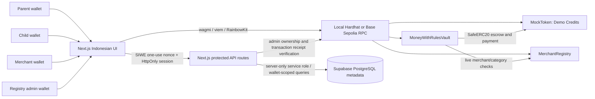
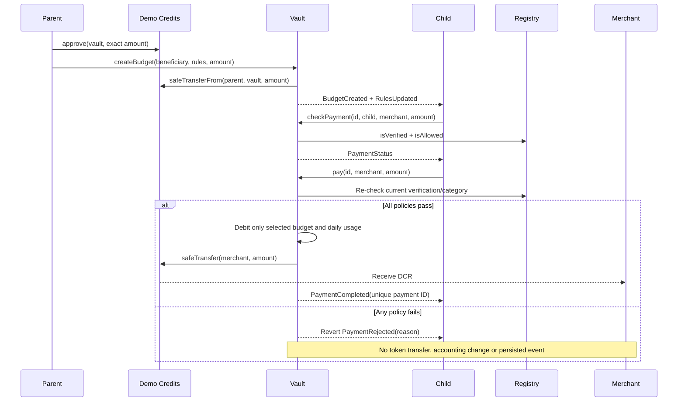

# Architecture and data model





## On-chain model

| Entity             | Key                                             | Authoritative state                                                                                         |
| ------------------ | ----------------------------------------------- | ----------------------------------------------------------------------------------------------------------- |
| Token              | Immutable token contract address                | DCR balances; 18 decimals; owner-only mint capped at 1,000,000 DCR                                          |
| Merchant           | Wallet address                                  | Four-bit category grant mask; suspended flag; current registry owner                                        |
| Merchant category  | 0..3                                            | FOOD, EDUCATION, TRANSPORT, OTHER; independently enabled by admin                                           |
| Budget             | Monotonic `uint256` ID                          | Immutable parent/beneficiary/name, mutable audited rules, independent accounting, pause and whitelist flags |
| Rules              | Budget ID                                       | Category, inclusive start/end Unix timestamps, positive transaction limit, optional daily limit             |
| Merchant whitelist | Budget ID + merchant                            | Explicit address permission, only considered when whitelist mode is enabled                                 |
| Daily spend        | Budget ID + `block.timestamp / 86400`           | Cumulative confirmed payments for that UTC day                                                              |
| Payment            | Monotonic payment ID + vault address + chain ID | `PaymentCompleted` receipt event; no off-chain row is required                                              |

A budget's accounting identity is:

```text
balance + totalSpent + totalWithdrawn + movedOut = totalFunded + movedIn
totalEscrow = sum(balance for every budget)
token.balanceOf(vault) >= totalEscrow
```

The last inequality permits unsolicited direct token donations. Such transfers do not fund a budget and cannot be recovered through an admin sweep. The normal demo flow has equality. Exact received amounts are checked; fee-on-transfer tokens are rejected. The app supports the deployed, non-rebasing MockToken, not arbitrary ERC-20 behavior.

Budget IDs never mix owners or beneficiaries. Parent-only reallocation requires a paused source, a distinct active/unexpired target, and identical parent/beneficiary pairs. The recipient receives an allocation inside escrow, not a withdrawable token balance. The name is bounded to 80 UTF-8 bytes; initial whitelist loops are capped at 32; per-wallet budget reads use pages of at most 100. Single-address whitelist edits are constant-time.

## Off-chain model

| Table                   | Purpose                                                              | Access                                                                                                        |
| ----------------------- | -------------------------------------------------------------------- | ------------------------------------------------------------------------------------------------------------- |
| `profiles`              | Display name and preferred UI role                                   | Session wallet only; admin is not an assignable profile role                                                  |
| `child_relationships`   | Parent-owned address labels                                          | Parent session wallet only; these labels never establish contract ownership                                   |
| `merchant_applications` | Business name, location, logo URL, category request, review metadata | Merchant owns submission; on-chain admin reviews; only approved public directory fields are returned publicly |
| `auth_nonces`           | Exact SIWE message, nonce, network, expiry, consumed marker          | Server only; issue-rate limited, atomically consumed                                                          |
| `wallet_sessions`       | SHA-256 bearer-token digest, wallet, chain, expiry                   | Server only; raw token stays in HttpOnly cookie                                                               |
| `payment_attempts`      | Optional failed/submitted UX attempts                                | Session wallet only; any supplied hash must match sender, vault, decoded pay arguments                        |

All tables enable RLS and deny `anon` and `authenticated`. Only the server service role is granted table access. The server is therefore a security boundary: it checks session, active-wallet header, origin on mutations, input schema, and wallet-specific query predicates. No client editable status or profile role authorizes a payment or admin operation. A successful application review is synchronized only after the on-chain merchant/category check passes.

## Reads and transaction lifecycle

`useChainData` verifies RPC chain ID, takes a latest-block snapshot, reads the account's paginated budgets, and scans events in 2,000-block requests. The UI refreshes after confirmed writes and every 20 seconds. Amounts use bigint base units; display formatting is limited to four decimal places, while contract calculations retain all 18 decimals.

Writes move through policy simulation, awaiting wallet signature, submitted/pending, then receipt-confirmed or failed states. Replacement/cancellation is distinguished from a fee-only speed-up. A receipt timeout retains the pending hash; it is not treated as a revert. A preflight preview may become stale, so `pay` always performs the same checks at execution time.

Failed transactions do not produce lasting events. An optional database attempt with a hash is verified against the actual sender and decoded call, then classified from the receipt. Unmined hashes remain pending. Hashless failed attempts are explicitly untrusted UX metadata and cannot masquerade as receipts.

## Scaling boundary

This MVP scans historical logs from the deployment block for correctness with small demo datasets. A production-sized deployment needs a reorg-aware event indexer, cursor pagination for activity, RPC rate limiting, monitoring, and finality rules. The indexer would be a read optimization; contracts would remain authoritative. Metadata listings are bounded to 100 private rows / 500 public merchant profiles and do not gate on-chain access.
