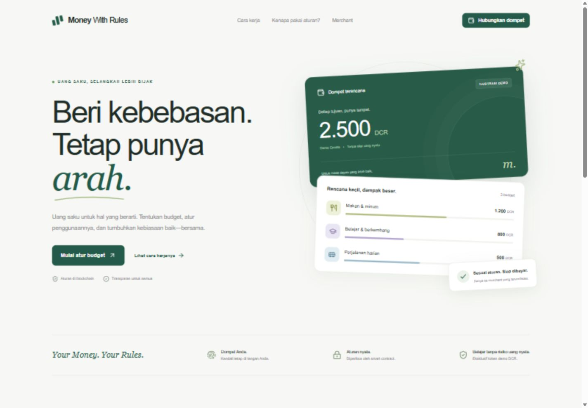

# Verification record

Validated locally on **2026-11-15**, Windows, Node.js 24.14.0, npm 11.9.0.

| Check | Observed result |
| --- | --- |
| Solidity compilation | PASS — 17 Solidity source files compiled with npm-pinned solc 0.8.28, optimizer and Paris EVM target |
| Hardhat contract suite | PASS — 40 tests |
| Application/PostgreSQL suite | PASS — 6 tests, including real migration execution in embedded PostgreSQL |
| ESLint | PASS — no lint errors or warnings |
| TypeScript | PASS — `tsc --noEmit` |
| Production build | PASS — Next.js 16.4.6, 22 generated routes/pages including protected server APIs |
| Local HTTP smoke suite | PASS — 20 assertions: 12 pages, 5 unauthenticated endpoint denials, 2 cross-origin denials, 1 malformed challenge denial |
| Local deployment and demo | PASS — real mint, approval, deposit, valid payment, merchant receipt, invalid payment revert, isolated accounting |
| Browser inspection | PASS — landing/dashboard navigation, real registry directory, category filter, wallet picker, budget whitelist control, disconnected submit guard, mobile navigation, dark mode |
| Hydration regression check | PASS — dark-theme reload and browser-local date initialization produced no new console warnings/errors; date defaults populated after hydration |
| Mobile navigation visibility | PASS — closed sidebar is hidden from accessibility/keyboard focus; merchant page has no horizontal overflow at tested mobile size |

The successful production build retains two non-blocking upstream webpack warnings: the unused MetaMask SDK's optional React Native storage module and a dynamic import in viem/Ox's Tempo support. Neither is used by the configured injected-wallet/WalletConnect flow on Hardhat or Base Sepolia. These warnings are disclosed rather than suppressed. The explicit x402 dependencies satisfy current Coinbase SDK optional peer imports pulled in through the wallet connector bundle; the app does not offer x402 or cash payments.

## Real local demo result

```json
{
  "result": "PASS",
  "minted": "2500 DCR",
  "budgetId": "1",
  "paid": "45 DCR",
  "remaining": "1155 DCR",
  "receipt": "0xf3d93290679062bdf02f7c2011bd5e90d6d3bbdc8fe0ce6113032053e4d67d9d",
  "rejectedWrongCategory": true,
  "isolatedAccounting": true
}
```

Local addresses in that run:

- DCR: `0x5FbDB2315678afecb367f032d93F642f64180aa3`
- Registry: `0xe7f1725E7734CE288F8367e1Bb143E90bb3F0512`
- Vault: `0x9fE46736679d2D9a65F0992F2272dE9f3c7fa6e0`
- Chain ID: `31337`

These addresses are development artifacts, not live testnet addresses. Local-chain state is ephemeral. Restarting Hardhat requires deployment/seeding again.

## Browser evidence

Desktop and mobile layouts were inspected in the Codex in-app browser. Merchant filtering reduced the live local registry to Ruang Buku when Education was selected. Dark mode and the mobile drawer worked. The create-budget submit button stayed disabled without a connected wallet, and enabling its whitelist revealed the address list. A theme hydration warning found during inspection was fixed and the reload rechecked cleanly.



## Verification boundaries

- No Base Sepolia transaction was sent: no deployer credentials or faucet funds were supplied.
- No hosted Supabase instance was connected. SQL behavior was tested in PGlite; protected endpoints were exercised over HTTP. The live hosted sign-in/application-review flow still needs the operator's Supabase configuration.
- The complete transaction workflow was exercised through real Hardhat signers and contracts. Browser-wallet signature prompts were not completed against a user wallet. No private wallet credentials were entered or stored.
- Camera QR scanning was implemented with a supported-browser fallback but was not exercised with a physical camera.
- Browser QA used the development server; the production bundle was successfully compiled and statically generated. No public/remote hosting deployment was claimed.

Reproduce with the commands in [README](../README.md) and [the demo walkthrough](DEMO.md).
